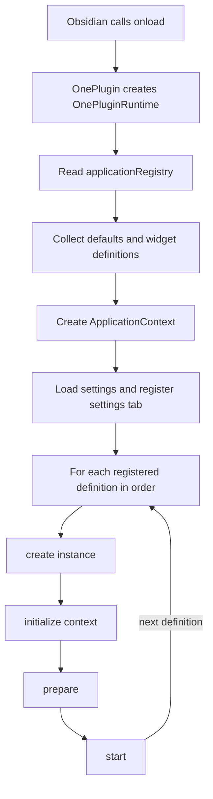
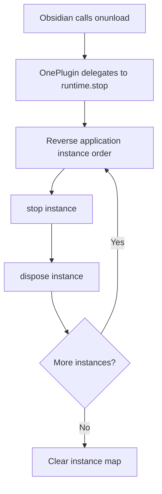

<!-- markdownlint-disable MD010 -->

# Plugin Runtime Architecture

This document describes the plugin-level runtime that currently exists in `src/`. It complements the system overview in [ARCHITECTURE.md](../../../ARCHITECTURE.md). It does not describe planned widget communication or application features that are not registered yet.

## Source Map

| Path                                                                            | Responsibility                                                                                        |
| ------------------------------------------------------------------------------- | ----------------------------------------------------------------------------------------------------- |
| [`src/main.ts`](../../../src/main.ts)                                           | Obsidian plugin entry point; creates and starts the runtime on load and stops it on unload.           |
| [`src/registry.ts`](../../../src/registry.ts)                                   | Compile-time composition point that registers application metadata.                                   |
| [`src/core/registry.ts`](../../../src/core/registry.ts)                         | Stores application definitions, rejects duplicate IDs, and returns definitions in registration order. |
| [`src/core/runtime.ts`](../../../src/core/runtime.ts)                           | Creates the shared application context, initializes settings, starts app instances, and stops them.   |
| [`src/core/platform/settingstab.ts`](../../../src/core/platform/settingstab.ts) | Loads and saves plugin settings through Obsidian and renders the settings tab.                        |
| [`src/core/types/application.ts`](../../../src/core/types/application.ts)       | Defines application metadata, context, and lifecycle methods.                                         |
| [`src/core/types/widget.ts`](../../../src/core/types/widget.ts)                 | Defines the current minimal widget metadata shape.                                                    |
| [`src/apps/`](../../../src/apps/)                                               | Application implementations and their metadata.                                                       |
| [`esbuild.config.mjs`](../../../esbuild.config.mjs)                             | Bundles the TypeScript entry point for the browser-based Obsidian runtime.                            |

## Load and Startup Flow

The build starts at `src/main.ts`. Obsidian constructs `OnePlugin`, calls `onload()`, and the plugin creates `OnePluginRuntime` with the Obsidian `App` and `Plugin` instances. The runtime then performs its startup steps in order:

1. Read registered definitions from the shared `applicationRegistry`.
2. Collect each definition's default settings into one object keyed by application ID. Collect widget definitions as well.
3. Create an `ApplicationContext` containing Obsidian's `App` and the plugin instance.
4. Create `OnePluginSettingTab`, load persisted plugin data, merge it over defaults, render the settings view, and register the tab with Obsidian.
5. For each application definition in registration order, call `create()`, store the instance, then await `initialize(context)`, `prepare()`, and `start()` sequentially.

Application startup is sequential, not parallel. A rejected startup lifecycle call rejects `start()`; the current runtime does not catch that failure in `OnePlugin.onload()` or roll back already-started applications.

## Registration and Application Contract

`src/registry.ts` is the composition root for application metadata. It creates an `ApplicationRegistry` and registers each definition. The registry uses a `Map`, so `getAll()` preserves registration order. Registering a second definition with the same `id` throws an error.

An [`ApplicationDefinition`](../../../src/core/types/application.ts) provides an `id`, display `name`, default `settings`, optional widget definitions, and a `create()` factory. The factory returns an `Application` instance with five asynchronous lifecycle methods: `initialize`, `prepare`, `start`, `stop`, and `dispose`. The current `ApplicationContext` provides only Obsidian's `App` and `Plugin` objects.

The currently registered definition is Hobby Manager, composed in [`src/registry.ts`](../../../src/registry.ts) from [`src/apps/hobbyManager/metadata.ts`](../../../src/apps/hobbyManager/metadata.ts). The New Tab metadata file is commented out and is not part of runtime startup. Check the registry before assuming an application is active.

## Settings and Collected Resources

Before creating application instances, the runtime builds `defaultSettings` as a record keyed by definition ID and passes it to `OnePluginSettingTab`. The setting tab loads saved plugin data with `plugin.loadData()` and merges persisted values over defaults. Saving uses `plugin.saveData()`.

The runtime also flattens optional widget definitions from registered applications. At present, the collected `widgets` and the `settingManager` returned by `getSettingObj()` are not passed into applications or otherwise consumed by the startup loop. Widget communication and application-specific settings wiring should therefore be treated as incomplete, not as a working cross-application API.

## Unload and Shutdown Flow

When Obsidian calls `onunload()`, `OnePlugin` delegates to `runtime.stop()`. The runtime copies its instances in reverse insertion order, then for each instance awaits `stop()` followed by `dispose()`. It logs and catches a failure per instance, continues through the remaining instances, and clears the instance map at the end.

Because `stop()` and `dispose()` for a given application are in the same `try` block, if `stop()` rejects, that application's `dispose()` is skipped; the runtime logs the failure and continues with the next application. Preserve or deliberately change this behavior with focused lifecycle tests if editing shutdown handling.

## Build Boundary

`esbuild.config.mjs` bundles `src/main.ts` and `src/styles.css` with `platform: 'browser'`, externalizes Obsidian and Node built-ins, and writes generated output to `build/<package-name>/`. Development builds watch source changes and include inline source maps; production builds are minified. The `build/` directory is generated and must not be edited by hand.

Application runtime code must remain browser-compatible. Node.js APIs belong only in development, test, and build scripts outside `src/`.

## Related Guides

- [Application architecture](APPLICATION.md) — application-level design; currently awaiting implementation-specific documentation.
- [Widget architecture](WIDGETS.md) — planned widget communication; not currently implemented by the runtime.
- [MarkDB architecture](MARKDB.md) — MarkDB design details.
- [Developer documentation index](../README.md) — setup, scripts, roadmap, and architecture guides.
