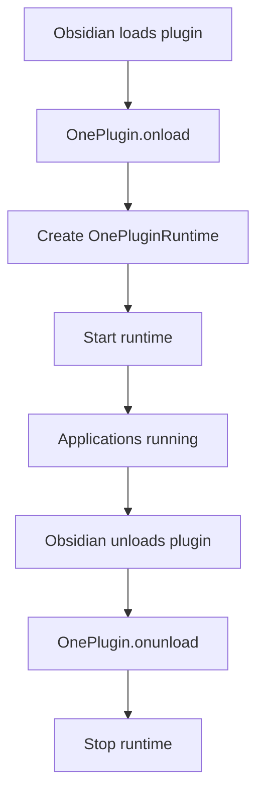
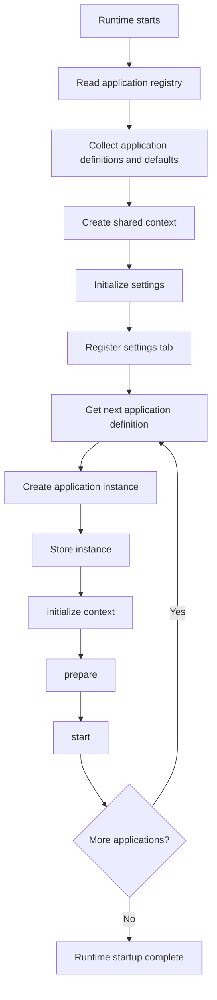
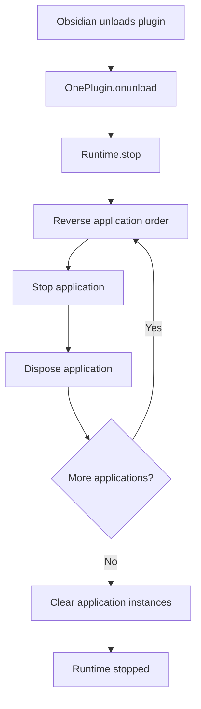

# Plugin Runtime Architecture

This document describes how the OnePlugin runtime is structured and how it manages the lifecycle of registered applications.

It covers the plugin entry point, application registry, runtime initialization, application startup, settings initialization, and shutdown process.

For the overall system design, see [ARCHITECTURE.md](../../../ARCHITECTURE.md).

## Source Structure

The plugin runtime is organized around the following components:

| Path                                                                            | Responsibility                                                                      |
| ------------------------------------------------------------------------------- | ----------------------------------------------------------------------------------- |
| [`src/main.ts`](../../../src/main.ts)                                           | Obsidian plugin entry point. Starts and stops the OnePlugin runtime.                |
| [`src/registry.ts`](../../../src/registry.ts)                                   | Creates the application registry and registers application definitions.             |
| [`src/core/registry.ts`](../../../src/core/registry.ts)                         | Provides the registry used to store and retrieve application definitions.           |
| [`src/core/runtime.ts`](../../../src/core/runtime.ts)                           | Coordinates plugin initialization, application creation, startup, and shutdown.     |
| [`src/core/platform/settingstab.ts`](../../../src/core/platform/settingstab.ts) | Manages plugin settings, loads persisted data, and provides the settings interface. |
| [`src/core/types/application.ts`](../../../src/core/types/application.ts)       | Defines application metadata, context, and lifecycle methods.                       |
| [`src/core/types/widget.ts`](../../../src/core/types/widget.ts)                 | Defines widget metadata.                                                            |
| [`src/apps/`](../../../src/apps/)                                               | Contains individual application implementations and their definitions.              |

## 1. Plugin Entry Point

OnePlugin runs inside Obsidian and uses its plugin lifecycle.

The entry point is `src/main.ts`, where `OnePlugin` extends Obsidian's `Plugin` class.

When Obsidian loads the plugin, it calls `onload()`. OnePlugin creates its central runtime and starts it.

When Obsidian unloads the plugin, `onunload()` delegates cleanup to the runtime.



The entry point should remain lightweight. Application registration, initialization, and lifecycle management belong to the runtime and its supporting components.

## 2. Application Registry

The application registry stores the definitions of applications that OnePlugin should load.

It is created in `src/registry.ts`, which acts as the composition root for the plugin.

Each application provides an `ApplicationDefinition` containing:

- A unique application ID.
- A display name.
- Default settings.
- Optional widget definitions.
- A `create()` factory method that returns an application instance.

### Creating the Registry

The registry is created once and populated with application definitions.

For example:

```ts
import { ApplicationRegistry } from '@/core/registry';
import hobbyManager from '@/apps/hobbyManager/metadata';

export const applicationRegistry = new ApplicationRegistry();

applicationRegistry.register(hobbyManager);
```

Each application is registered explicitly at compile time.

The registry should not automatically discover applications by scanning directories. Only definitions explicitly registered in `src/registry.ts` are included in the runtime.

### Registry Responsibilities

`ApplicationRegistry` provides methods to:

| Method                 | Responsibility                                             |
| ---------------------- | ---------------------------------------------------------- |
| `register(definition)` | Register an application definition.                        |
| `get(id)`              | Retrieve an application definition by ID.                  |
| `getAll()`             | Retrieve all registered definitions in registration order. |
| `has(id)`              | Check whether an application is registered.                |

Application IDs must be unique. Registering an application with an existing ID should throw an error.

The registry stores definitions, not running application instances. Creating and managing instances is the responsibility of the runtime.

## 3. Runtime Initialization

`OnePluginRuntime` is the central coordinator of OnePlugin.

It receives the Obsidian `App` and `Plugin` instances and manages the initialization and lifecycle of registered applications.

When `start()` is called, the runtime performs the following steps:

1. Retrieve all registered application definitions from `applicationRegistry`.
2. Collect application defaults and other registered resources.
3. Create the shared `ApplicationContext`.
4. Initialize the plugin settings system.
5. Create and initialize application instances.
6. Start applications in registry order.

The runtime should complete each initialization step before moving to the next one.

### Collecting Registered Resources

Before creating application instances, the runtime collects the resources contributed by registered definitions.

This includes:

- Application definitions.
- Default application settings.
- Optional widget definitions.

Default settings are organized by application ID so that each application's settings remain separate.

For example:

```ts
{
    "hobby-manager": {
        enabled: true,
        theme: "default"
    }
}
```

The runtime uses these collected defaults to initialize the shared settings system.

### Application Context

Each application receives an `ApplicationContext` during initialization.

The context provides access to shared resources and services that applications need to work inside OnePlugin.

It should include:

- Obsidian's `App` instance.
- The main Obsidian `Plugin` instance.
- Shared settings access.
- The application registry.
- Other shared services as they become available.

Applications should use the shared instances provided through the context rather than creating their own copies of plugin-wide services.

The context is provided through the application's `initialize()` method.

## 4. Settings Initialization

Before starting applications, the runtime initializes `OnePluginSettingTab`.

The settings system is responsible for managing plugin-wide and application-specific settings.

Its initialization process should:

1. Receive the default settings collected from registered applications.
2. Load previously saved settings using Obsidian's `loadData()`.
3. Merge saved values over the default settings.
4. Preserve defaults for settings that do not have saved values.
5. Register the settings tab with Obsidian.
6. Provide applications with access to their settings through the shared settings interface.

Saving settings should use Obsidian's `saveData()` method.

The settings system should provide a consistent way for applications to retrieve and update their own settings without directly managing plugin storage.

## 5. Application Creation and Startup

After the registry and shared services have been initialized, the runtime starts the registered applications.

For each registered definition, the runtime calls its `create()` method to obtain a new application instance.

The instance is then stored by its application ID and initialized using the following lifecycle:

| Stage                 | Responsibility                                                                   |
| --------------------- | -------------------------------------------------------------------------------- |
| `create()`            | Create a new application instance from its definition.                           |
| `initialize(context)` | Provide the application with its shared context and initialize its dependencies. |
| `prepare()`           | Prepare the resources required before the application starts.                    |
| `start()`             | Start the application's functionality.                                           |

Each stage must complete before the next one begins.

Applications are started sequentially in registry order, not in parallel.



The runtime should not start the next application until the current application has completed its startup lifecycle.

### Startup Failure Handling

Application startup should be treated as an ordered process.

If an application fails during initialization, preparation, or startup, the runtime must report the failure clearly.

The runtime should also handle already-created instances and previously started applications safely. Failed startup must not leave the plugin in an undefined state.

The cleanup behavior for failed startup should be covered by lifecycle tests.

## 6. Application Lifecycle

The runtime manages the complete lifecycle of every registered application.

Each application follows five lifecycle methods:

- **Initialize:** Receive the shared context and initialize dependencies.
- **Prepare:** Prepare resources required by the application.
- **Start:** Begin the application's functionality.
- **Stop:** Stop running processes and activities.
- **Dispose:** Release resources owned by the application.

The runtime calls the first three methods during startup and the last two during shutdown.

Applications should manage their own internal resources and should not interfere with the lifecycle of other applications.

## 7. Unload and Shutdown

When Obsidian unloads OnePlugin, the entry point calls `runtime.stop()`.

The runtime is responsible for shutting down all created application instances.

Applications should be stopped in reverse registration order so that applications started later are stopped first.

For each application, the runtime:

1. Calls `stop()` to stop its running functionality.
2. Calls `dispose()` to release its resources.
3. Continues with the next application.
4. Clears its instance references after shutdown.



Shutdown should continue even if an individual application fails to stop or dispose.

A failure in one application must not prevent the remaining applications from being cleaned up.

The runtime should ensure that disposal is attempted even when stopping an application fails.

## 8. Build Boundary

OnePlugin is bundled for the browser-based Obsidian runtime using `esbuild.config.mjs`.

The build process:

- Uses `src/main.ts` as the JavaScript entry point.
- Includes `src/styles.css`.
- Uses `platform: 'browser'`.
- Bundles application and shared runtime code.
- Keeps Obsidian APIs and Node.js built-ins external.
- Generates output under `build/<package-name>/`.

Development builds watch source changes and include inline source maps. Production builds are minified.

The `build/` directory is generated output and must not be edited manually.

**Runtime compatibility:** Application code must remain browser-compatible. Node.js modules and APIs must only be used in development, testing, and build tooling outside the plugin runtime.

## Related Guides

- [Application Architecture](APPLICATION.md) — How individual applications are structured and managed.
- [Widget Architecture](WIDGETS.md) — How applications will communicate and share functionality through widgets.
- [MarkDB Architecture](MARKDB.md) — How OnePlugin manages and accesses data.
- [Developer Documentation](../README.md) — Development setup, scripts, and other developer resources.
