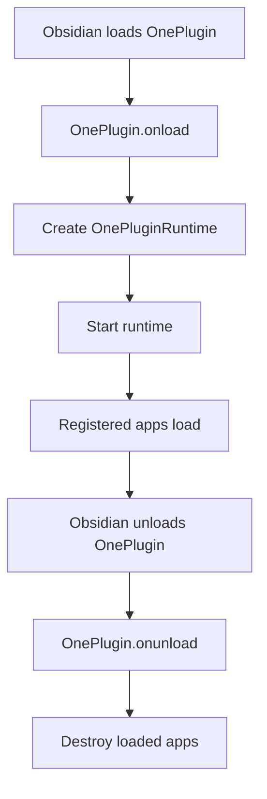
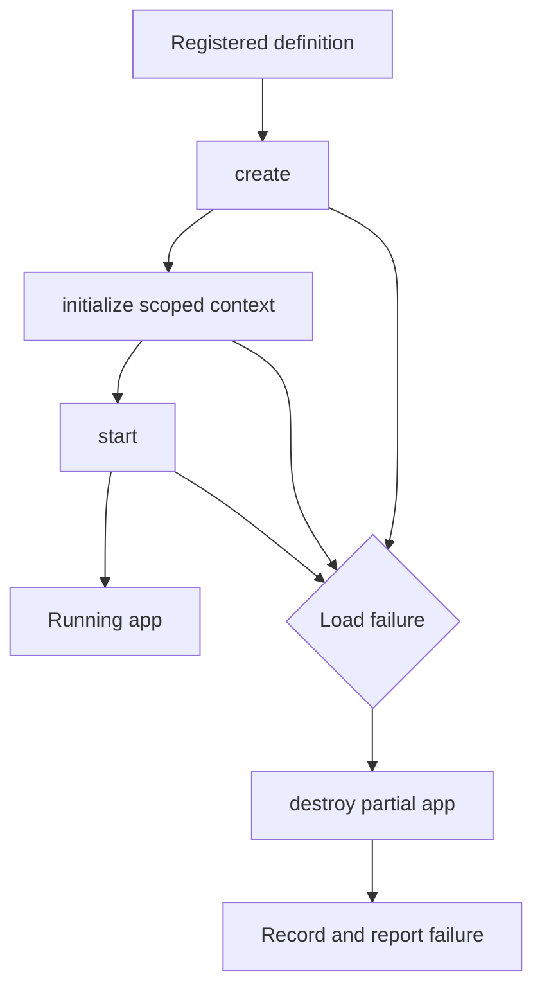

# Plugin Runtime Architecture

This document describes the OnePlugin boundary: from Obsidian loading the plugin to registered applications loading, and later being destroyed when Obsidian unloads the plugin.

It does not define application views, application-specific behaviour, or the final MarkDB and widget designs. MarkDB and widget contracts remain placeholders while those areas are migrated and designed.

For the system overview, see [ARCHITECTURE.md](../../../ARCHITECTURE.md).

## Source structure

| Path | Responsibility |
| --- | --- |
| [`src/main.ts`](../../../src/main.ts) | Obsidian plugin entry point. Creates and delegates to the runtime. |
| [`src/registry.ts`](../../../src/registry.ts) | Composition root that explicitly registers application definitions. |
| [`src/core/registry.ts`](../../../src/core/registry.ts) | Stores definitions and rejects duplicate IDs. |
| [`src/core/runtime.ts`](../../../src/core/runtime.ts) | Creates shared plugin services and coordinates application loading and shutdown. |
| [`src/core/platform/settingstab.ts`](../../../src/core/platform/settingstab.ts) | Loads, saves, and renders plugin settings. |
| [`src/core/types.ts`](../../../src/core/types.ts) | Defines application metadata, shared settings, lifecycle, and placeholder service contracts. |
| [`src/utils/dirtyObj.ts`](../../../src/utils/dirtyObj.ts) | Shared dirty-state tracking and snapshot utility. |

## Plugin entry point

`OnePlugin` extends Obsidian's `Plugin`. Its only job is to create `OnePluginRuntime` in `onload()` and ask it to start. During `onunload()`, it asks the runtime to stop.



`src/main.ts` stays lightweight. It does not create application instances or application views.

## Application registry

`src/registry.ts` is the composition root. It manually registers the applications included in the plugin build.

An `ApplicationDefinition` contains:

- A unique ID.
- A display name.
- Its default settings.
- Optional placeholder widget definitions.
- A `create()` factory that creates its application instance.

Manual registration is intentional for now. A future compile-time generator may produce this file, but the runtime must not scan application directories or discover applications dynamically.

`ApplicationRegistry` preserves definitions and detects duplicate IDs. It never stores running application instances.

## Runtime startup

When `start()` runs, the runtime:

1. Reads the registered definitions and collects their default settings.
2. Creates and initializes the plugin settings tab.
3. Creates one shared application context.
4. Creates and loads all applications independently.

Applications are allowed to load in parallel. They must not depend on another application's load order or private state.

The shared context currently includes a `FakeMarkDb` placeholder so application code can be written against the future MarkDB service. It does not make MarkDB migration complete. Widget definitions are likewise collected and retained as placeholders, but have no communication API or runtime behaviour yet.

## Settings

Application defaults are stored under their application ID:

```ts
{
    "hobby-manager": {
        enabled: true,
    },
}
```

Saved settings override defaults while retaining omitted default keys. The shared `SettingContext` reads settings by application ID. For example, `context.setting.getSetting('hobby-manager')` returns Hobby Manager's settings object. `register()` and widget settings behaviour are placeholders until change notifications and application-level settings contracts are designed.

The settings tab renders plugin-wide settings. An application may ask the shared settings context for a named container in that tab if it has settings to render there. This is optional and is not an application main view; applications create their own user-facing views through Obsidian when needed.

## Application lifecycle

Each application has three lifecycle methods:

| Stage | Responsibility |
| --- | --- |
| `initialize(context)` | Receive the scoped context and set up dependencies. |
| `start()` | Start application behaviour. |
| `destroy()` | Stop all application work and release resources. It must also be safe after partial startup. |

For each definition, the runtime calls `create()`, `initialize(context)`, and `start()`.

If an application fails while it loads, the runtime calls `destroy()` on that partially created instance, records and reports the failure, and continues loading the other applications. A failed app is not treated as running.



## Shutdown

On unload, the runtime calls `destroy()` for every running application. A failure from one app is logged and does not prevent the runtime from destroying the remaining applications. The runtime then saves settings and clears its references.

## Build boundary

OnePlugin runtime code is bundled for Obsidian's browser-compatible environment. Runtime modules must not use Node.js-only APIs. The build uses `src/main.ts` as its entry point and writes generated output under `build/<package-name>/`.

## Related guides

- [Application Architecture](APPLICATION.md) — Application-specific structure and behaviour.
- [Dirty Object Architecture](DIRTY-OBJECT.md) — Shared mutable-state tracking, snapshots, and save coordination.
- [MarkDB Architecture](MARKDB.md) — MarkDB storage and data flow.
- [Widget Architecture](WIDGETS.md) — Planned widget communication work.
- [Developer Documentation](../README.md) — Development workflows and references.
